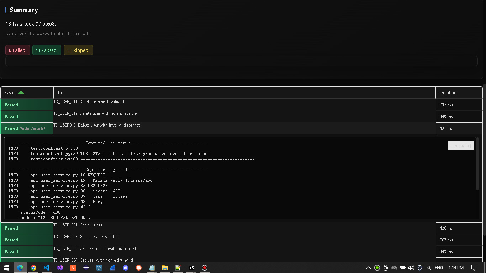
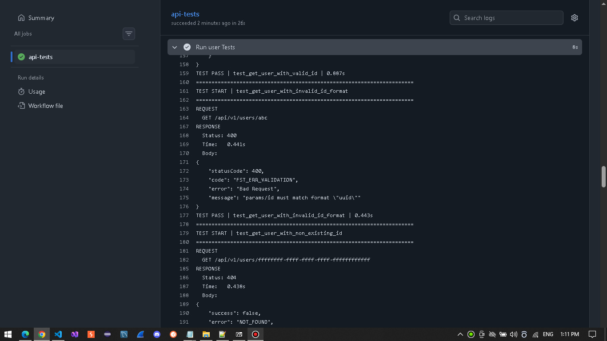

<a id="top"></a>
# Project 10 – REST API Automation Framework 


> **Note:** This project is part of my personal QA Automation portfolio.

## Table of Contents

- [Overview](#overview)
- [Tech Stack](#tech-stack)
- [Framework Features](#framework-features)
- [Framework Architecture](#framework-architecture)
- [Test Execution](#test-execution)
- [Reports and Logging](#reports-and-logging)
- [Conclusion](#conclusion)

---

## 📖 Overview

A modular API automation framework built in **Python** with **Pytest.**
The framework covers CRUD operations for the following REST services:
- Users
- Products

Both positive and negative scenarios are automated, including validation and boundary testing.

---

<a id="tech-stack"></a>
## 🛠️ Tech Stack

| Technology | Purpose |
|------------|---------|
| Python | Programming language used for test implementation |
| Pytest | Test execution, fixtures, assertions, and test organization |
| Requests | HTTP client used for REST API communication |
| jsonschema | JSON response schema validation |
| pytest-html | HTML test report generation |
| pytest-check | Multiple assertions within a single test |
| Python logging | Structured API request/response and test execution logging |
| GitHub Actions | CI workflow for automated test execution |

---

## ✨ Framework Features

- **Modular API Architecture:** Structured API services designed with Pytest.
- **Custom Pytest Fixtures:** Reusable test setup and dependency management through custom fixtures.
- **JSON Schema Validation:** API response validation using `jsonschema.`
- **Custom Test Markers:** Test categorization and selective execution using custom pytest markers.
- **Test Reporting:** Detailed test reports generated with `pytest-html.`
- **Detailed API Logging:** API request/response logging using Python's built-in `logging` module.
- Test execution control through **Pytest parameters.**
- **GitHub Actions CI:** Two workflows for automated test execution (one manually triggered and one triggered on Pull Requests).

---

<a id="framework-architecture"></a>
## 🏗️ Framework Architecture

The framework is organized into dedicated layers, each with a clear responsibility to improve
maintainability, reusability, and separation of concerns.

| Component | Purpose |
|-----------|---------|
| `services` | Encapsulates REST API endpoints and HTTP operations |
| `base_service` | Provides shared HTTP request handling and API logging |
| `fixtures` | Provides reusable test setup, payloads, schemas, and service instances |
| `test_data` | Contains request payloads and expected JSON response schemas |
| `tests` | Contains API test scenarios organized by resource and operation |
| `conftest.py` | Centralizes Pytest fixtures, test hooks, reporting, and test execution logging |
| `pytest.ini` | Contains Pytest configuration and custom test markers |
| `reports` | Stores generated HTML test reports |
| `.github/workflows` | Contains GitHub Actions CI workflows |


---

## Test Execution

### Run All Tests

```bash
# Run all tests without generating report(26 tests)
python -m pytest

# Run all tests with HTML report, logging, and custom styling (26 tests)
python -m pytest --html=reports/all_tests.html --self-contained-html --css=report_style.css -s
```

### Run Specific Test Suite 

```bash
# Run smoke tests with HTML report, logging, and custom styling (10 tests)
python -m pytest -m smoke --html=reports/smoke.html --self-contained-html --css=report_style.css -s

# Run product module tests with HTML report, logging, and custom styling (13 tests)
python -m pytest -m product --html=reports/product.html --self-contained-html --css=report_style.css -s
```

---

## Reports and Logging

### Reports

Test execution **reports** are generated using `pytest-html` and located in the `reports/` directory.

<details>
<summary>📊 <strong>Report Preview</strong></summary>

<br>



</details>

### Logs

**Detailed API execution logs** are generated using Python's built-in logging module.

<details>
<summary>📝 <strong>Logs Preview</strong></summary>

<br>



</details>

---

## Conclusion

The main focus of this project was to demonstrate a solid understanding of core API Automation concepts, particularly 
REST API testing, and their practical application within a structured and configurable framework, using Python and Pytest.

**Author:** [DoruSQA](https://github.com/DoruSQA) | [LinkedIn](https://www.linkedin.com/in/sava-doru/)
<p align="right"><a href="#top">Back to Top</a></p>